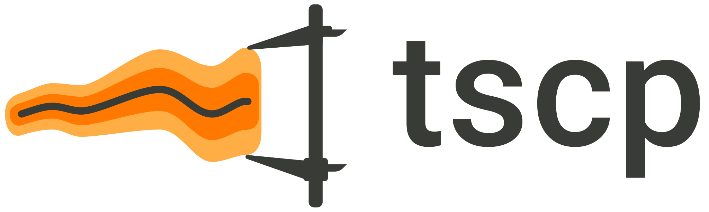

<div align="center">
  <picture>
    <source media="(prefers-color-scheme: dark)" srcset="tscp-logo-assets/tscp-horizontal-dark.svg">
    <source media="(prefers-color-scheme: light)" srcset="tscp-logo-assets/tscp-horizontal.svg">
    
  </picture>

  <p><strong>Conformal prediction for time series, in PyTorch.</strong></p>

  <p>
    <a href="https://github.com/RobertoNeglia/tscp/actions/workflows/ci.yaml"></a>
    <a href="https://tscp.readthedocs.io/en/latest/"></a>
    <a href="pyproject.toml"></a>
    <a href="https://pytorch.org/"></a>
    <a href="LICENSE"></a>
  </p>

  <p>
    <a href="https://tscp.readthedocs.io/en/latest/">Documentation</a> &middot;
    <a href="#quickstart">Quickstart</a> &middot;
    <a href="#methods-and-implementation-status">Methods</a> &middot;
    <a href="examples/">Examples</a> &middot;
    <a href="CONTRIBUTING.md">Contributing</a>
  </p>
</div>

---

**tscp** is a PyTorch library for post-hoc conformal prediction on time series.
Build, compare and extend published methods from forecast residuals, with composable
calibration components and causal online updates.

- **One workflow:** `fit` → `calibrate` → `predict` across published methods.
- **Composable calibration:** interchangeable sources, scores, weights, quantile models
  and online updates.
- **Shared evaluation:** coverage and region-size metrics, with saved methods and
  deterministic replay.

**Status:** early development. See the [method documentation](docs/source/methods.md)
for supported inputs, optional dependencies and deviations from reference implementations.

## Install

Install the development version from source:

```bash
pip install "git+https://github.com/RobertoNeglia/tscp.git"
```

For development, clone the repository and install it with `pip install -e ".[dev]"`.
Documentation: https://tscp.readthedocs.io

## Quickstart

```python
from tscp.datasets import variance_shift
from tscp.methods import get_method
from tscp.metrics import evaluate

archive = variance_shift(horizon=1)  # a synthetic residual archive
method = get_method("nexcp", decay=0.99, alpha=0.1)
region = method.fit(archive).calibrate(archive).predict(archive)
print(evaluate(region, archive.split("test"), alpha=0.1, window=200))
```

`examples/quickstart.py` compares the three methods on two synthetic archives.

## Methods and implementation status

Literature snapshot checked on **11 November 2026**. The conference table covers
forecast intervals and regions, together with general online calibration methods. The
search covered archival research tracks at NeurIPS, ICML, ICLR, COLT, AISTATS, UAI,
AAAI, IJCAI and KDD.
Workshop papers, preprints, classification-only methods and anomaly detection are outside
this inventory. Each method links to its paper or official publication record; related
algorithms from the same paper share a row.

**Implemented** means the documented post-hoc construction is available in tscp.
See the [method documentation](docs/source/methods.md) for supported inputs, optional
dependencies and deviations from the paper. **Not implemented** means the named method
is absent, even when some of its building blocks are available.

| Method / paper | Venue | Setting | Status in tscp |
|---|---|---|---|
| [Block-permutation conformal inference](https://proceedings.mlr.press/v75/chernozhukov18a.html) | COLT 2018 | Dependent-data prediction through block permutations | Not implemented |
| [ACI](https://papers.neurips.cc/paper/2021/hash/0d441de75945e5acbc865406fc9a2559-Abstract.html) | NeurIPS 2021 | Online miscoverage-level adaptation | Implemented: `ACI` |
| [EnbPI](https://proceedings.mlr.press/v139/xu21h.html) | ICML 2021 | Bootstrap/OOB sequential prediction intervals | Implemented: `EnbPI` (journal variant; see below) |
| [CF-RNN](https://proceedings.neurips.cc/paper_files/paper/2021/hash/312f1ba2a72318edaaa995a67835fad5-Abstract.html) | NeurIPS 2021 | Joint multi-horizon intervals across exchangeable trajectories | Not implemented |
| [AgACI](https://proceedings.mlr.press/v162/zaffran22a.html) | ICML 2022 | Aggregation of ACI experts at each interval endpoint | Implemented: `AgACI` |
| [TQA](https://papers.neurips.cc/paper_files/paper/2022/hash/c8d2860e1b51a1ffadc7ed0a06f8d8f5-Abstract-Conference.html) | NeurIPS 2022 | Temporal quantile adjustments for panel time series | Not implemented |
| [MVP](https://proceedings.neurips.cc/paper_files/paper/2022/hash/bcdaaa1aec3ae2aa39542acefdec4e4b-Abstract.html) | NeurIPS 2022 | General online threshold- and group-conditional calibration | Not implemented |
| [SPCI](https://proceedings.mlr.press/v202/xu23r.html) | ICML 2023 | Conditional residual quantiles from recent residual history | Implemented: `SPCI` |
| [SAOCP / SF-OGD](https://proceedings.mlr.press/v202/bhatnagar23a.html) | ICML 2023 | Strongly adaptive experts and scale-free quantile tracking | Not implemented |
| [HopCPT](https://papers.neurips.cc/paper_files/paper/2023/hash/aef75887979ae1287b5deb54a1e3cbda-Abstract-Conference.html) | NeurIPS 2023 | Residual retrieval with modern Hopfield networks | Not implemented |
| [Conformal PI / PID](https://papers.neurips.cc/paper_files/paper/2023/hash/47f2fad8c1111d07f83c91be7870f8db-Abstract-Conference.html) | NeurIPS 2023 | Quantile tracking, error integration and scorecasting | Implemented: `ConformalPI`, `ConformalPID` |
| [IPOC](https://doi.org/10.1145/3580305.3599396) | KDD 2023 | Online workload intervals using chasing and model selection | Not implemented |
| [CopulaCPTS](https://proceedings.iclr.cc/paper_files/paper/2024/hash/8707924df5e207fa496f729f49069446-Abstract-Conference.html) | ICLR 2024 | Copula-based joint multi-step regions | Not implemented |
| [LCP-optimized trajectory regions](https://ojs.aaai.org/index.php/AAAI/article/view/30089) | AAAI 2024, special technical track | Joint regions with optimized horizon weights | Not implemented |
| [MultiDimSPCI](https://proceedings.mlr.press/v235/xu24m.html) | ICML 2024 | Ellipsoidal regions for multivariate time series | Not implemented |
| [Online CP with decaying step sizes](https://proceedings.mlr.press/v235/angelopoulos24a.html) | ICML 2024 | Quantile tracking with diminishing learning rates | Not implemented |
| [Adaptive conformal inference by betting](https://proceedings.mlr.press/v235/podkopaev24a.html) | ICML 2024 | Parameter-free online quantile tracking | Not implemented |
| [CT-SSF](https://papers.neurips.cc/paper_files/paper/2024/hash/dbfb7b1443583fc7ab87e8b1b4f48c9c-Abstract-Conference.html) | NeurIPS 2024 | Learned semantic features and dynamic calibration weights | Not implemented |
| [KOWCPI](https://proceedings.iclr.cc/paper_files/paper/2025/hash/058983528186511a74968e88a6d0ad63-Abstract-Conference.html) | ICLR 2025 | Kernel-weighted conditional residual quantiles | Not implemented |
| [ECI](https://proceedings.iclr.cc/paper_files/paper/2025/hash/cab5ae2704d3e01f06a92512a5376b87-Abstract-Conference.html) | ICLR 2025 | Error-magnitude feedback for online threshold adaptation | Not implemented |
| [NCC](https://ojs.aaai.org/index.php/AAAI/article/view/34029) | AAAI 2025 | Neural conformal control with auxiliary context | Not implemented |
| [LQT / SQT with scorecasting](https://proceedings.mlr.press/v267/areces25a.html) | ICML 2025 | Online optimization with scalar or linear quantile trackers | Not implemented |
| [CoRel](https://proceedings.mlr.press/v267/cini25a.html) | ICML 2025 | Relational calibration across correlated time series | Not implemented |
| [UC-MTCP](https://ijcai.org/proceedings/2025/1079) | IJCAI 2025, AI and Social Good track | Upper-bound-calibrated multi-horizon energy forecasts | Not implemented |
| [CPTC](https://proceedings.neurips.cc/paper_files/paper/2025/hash/12271b64c483ad8f6192eb6aaa102044-Abstract-Conference.html) | NeurIPS 2025 | Change-point-aware time-series calibration | Not implemented |
| [STACI](https://proceedings.neurips.cc/paper_files/paper/2025/hash/806288e682d8a38c0bf21e37ab38af0a-Abstract-Conference.html) | NeurIPS 2025 | Topology-aware prediction for stream networks | Not implemented |
| [ResCP](https://proceedings.iclr.cc/paper_files/paper/2026/hash/b0a978efeb20d33c15e31a5beee9f6df-Abstract-Conference.html) | ICLR 2026 | Reservoir-state similarity weighting of residuals | Not implemented |
| [FCP](https://proceedings.iclr.cc/paper_files/paper/2026/hash/b95866d282e9667f9ea534cf243d7f93-Abstract-Conference.html) | ICLR 2026 | Flow-based regions for multidimensional time series | Not implemented |
| [JAPAN](https://proceedings.iclr.cc/paper_files/paper/2026/hash/d4f48e70729743aaeb4e964a991d7812-Abstract-Conference.html) | ICLR 2026 | Flow-density regions, including time-series trajectories | Not implemented |
| [COP](https://proceedings.iclr.cc/paper_files/paper/2026/hash/5f8241131e6fd428aa49914da76b8ad0-Abstract-Conference.html) | ICLR 2026 | Optimistic online updates informed by score distributions | Not implemented |
| [CQACP](https://proceedings.mlr.press/v306/yu26by.html) | ICML 2026 | Monotone conditional quantile-curve adjustment | Not implemented |
| [DistMatch](https://proceedings.mlr.press/v306/menadjiev26a.html) | ICML 2026 | Residual-distribution partitioning and online quantile updates | Not implemented |
| [SCALE](https://proceedings.mlr.press/v306/guo26d.html) | ICML 2026 | Graph-wavelet calibration for multivariate time series | Not implemented |
| [UP-OCP](https://proceedings.mlr.press/v306/liu26y.html) | ICML 2026 | Parameter-free online intervals via portfolio algorithms | Not implemented |
| [COMA](https://proceedings.mlr.press/v337/gasparin26a.html) | UAI 2026 | Adaptive aggregation of conformal prediction sets | Not implemented |

AgACI, EnbPI and SPCI currently support one-step, univariate archives. EnbPI implements
the [2023 journal construction](https://doi.org/10.1109/TPAMI.2023.3272339) with externally
supplied bootstrap forecasts. SPCI uses the exact quantile-forest estimator (`forest`
extra); the Theta scorecaster for PID uses the `pid` extra. CF-RNN, CopulaCPTS and JAPAN
use exchangeability across trajectories while allowing temporal dependence within them.

The library also implements these general foundations and journal methods:

| Method / paper | Publication | Status in tscp |
|---|---|---|
| [Split conformal prediction](https://doi.org/10.1080/01621459.2017.1307116) | JASA 2018 | Implemented: `SplitCP`, with absolute, signed or normalized scores |
| [CQR](https://papers.neurips.cc/paper_files/paper/2019/hash/5103c3584b063c431bd1268e9b5e76fb-Abstract.html) | NeurIPS 2019; general regression | Implemented: `SplitCP(score=CQRScore(...))` |
| [Mondrian conformal prediction](https://proceedings.mlr.press/v25/vovk12.html) | ACML 2012; general conditional coverage | Implemented: `MondrianCP` |
| [NexCP](https://doi.org/10.1214/23-AOS2276) | Annals of Statistics 2023 | Implemented: `NexCP` |
| [DtACI](https://jmlr.org/papers/v25/22-1218.html) | JMLR 2024 | Implemented: deterministic Algorithm 2, `DtACI` |
| Rolling-window calibration | Generic composition | Implemented: `WindowedCP`, `ExpandingSource(window_size=...)` |

## Build your own method

A method is one component per axis: residual source, score, calibration weights, quantile
model, online update. `compose` builds one from short names, such as a spec read from YAML:

```python
from tscp.methods import compose

method = compose(
    {
        "score": "signed",
        "source": "expanding",
        "weights": {"name": "exponential", "decay": 0.99},
        "update": {"name": "aci", "gamma": 0.005},
    }
)
```

A new component subclasses its axis's base class, and `tscp.testing` checks that it keeps
the contracts every method relies on, such as causality and split discipline:

```python
from tscp.testing import check_method

check_method(lambda: compose({"score": "signed", "update": "aci"}))
```

Packages can register components under short names as plugins. The tutorials in `docs/`
cover composing methods, writing components, learned components, plugins and batch
production; the code they show is in `examples/` and runs in the tests.

## Batch production

```python
from tscp.data import ResidualArchive
from tscp.methods import load_method, save_method

archive = ResidualArchive.from_forecasts(
    truth, forecasts, sizes={"fit": 0.2, "calibration": 0.3, "test": None}
)
save_method(method.fit(archive), "method.npz")  # one file, no pickle
region = load_method("method.npz").calibrate(archive).predict(archive)
intervals = region.to_target(archive.split("test").forecasts)
```

[Contributing](CONTRIBUTING.md) · [MIT license](LICENSE) ·
[Logo assets and usage](tscp-logo-assets/README.md)
